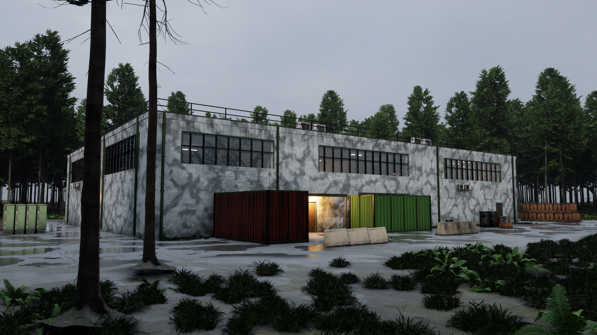
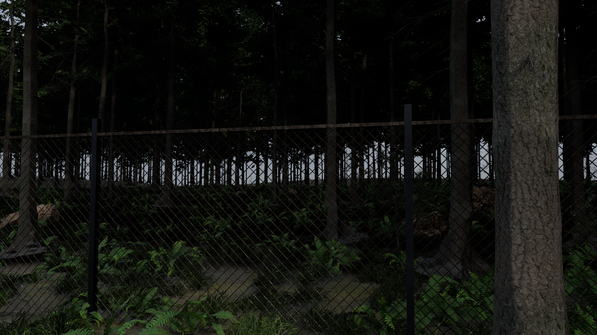
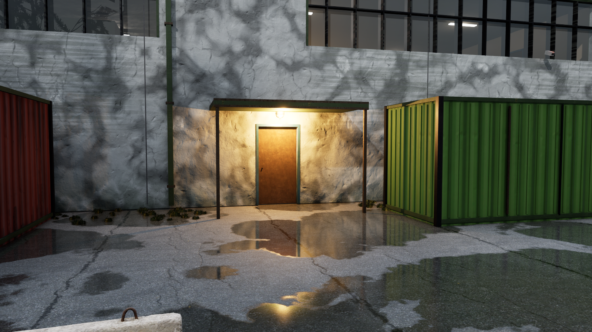
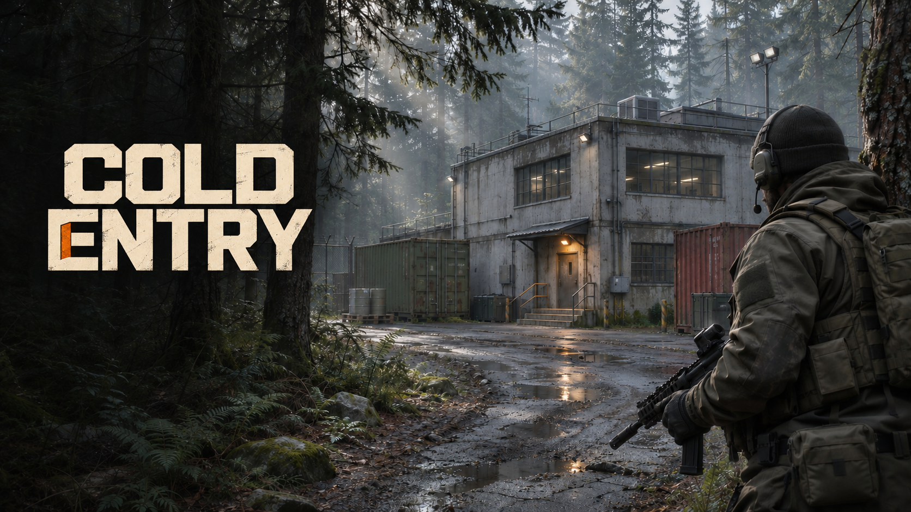

# Forest and facility polish — November 13, 2026

This update brings the Kessler Annex closer to the ColdEntry forest reference:
dense conifers, grassy shoulders, weathered industrial walls, cool ambient light,
a warm entrance and a wet service yard. These screenshots are captured in Unreal;
the separate branding images are generated concept artwork.

## In-game screenshots







## What changed

- Added roughly 2,400 mature firs, additional saplings, 34,000 grass/fern instances,
  boulders and deadwood using Poly Haven scans. Density and random seed are tunable.
- Repaired the source trees' UV export and preserved artist-authored foliage LODs.
  Masked, two-sided foliage now retains its full branch coverage.
- Added terrain around the compound, forest-soil shoulders and damp asphalt with
  irregular reflective puddles. Grass and ferns align to the terrain slope.
- Added scanned gray concrete/peeling paint, damp wall footings, runoff marks,
  larger factory windows, mullions, downpipes, roof rails and HVAC equipment.
- Added corrugated red/olive containers and a supported canopy with amber lighting;
  replaced several plain utility blocks with scanned props.
- Balanced the overcast ambient light, directional light, fog and exposure.
  A separate interior exposure volume preserves room visibility and blends at doors.
- Grounded plants against the actual terrain triangles, embedded rock bases,
  stacked crates using their mesh bounds, and added supports to floating fixtures.
- Added a repeatable seven-camera environment review mode.

## Logo, cover and menu artwork

- [Transparent logo](Artwork/ColdEntry-Logo-Transparent.png)
- [Game cover](Artwork/ColdEntry-Cover.png)
- [Menu / loading-screen background and visual reference](Artwork/ColdEntry-Menu-Background.png)
- [Generation prompts](Artwork/Generation-Prompts.json)



The editable source PNGs are also kept in `SourceArt/Branding`. The logo and menu
background are imported as Unreal UI textures under `Content/UI/Branding` for
menu/loading-screen integration. This pass does not add a new loading-screen flow.

## Verification

- `ColdEntryEditor Win64 Development` builds successfully with Unreal Engine 5.8.
- The forest import/material commandlet completes with zero errors. The existing
  Python-exposed `CEGadget` name collision warning remains unrelated to this pass.
- The standalone environment review runs at 1600 × 900, captures seven views and
  exits normally. Exterior, entrance, Comms and workshop shots were inspected for
  material and grounding problems.
- The reviewed views show corrected plant/rock grounding and supported fixtures.
  This is a sampled visual check, not a claim that every prop on the map was inspected.
- Full combat balance, every breach route and performance across other PCs need
  playtesting after the added solid containers and denser vegetation.

## Run or reproduce

Use `Build_ColdEntry.bat`, then `Play_Standalone.bat` with Unreal Engine 5.8 installed.
The repository includes imported assets; a source reimport is not required to play.
This is the complete Unreal project update, not a packaged Windows executable.

For a repeatable screenshot review, launch `UnrealEditor.exe` with:

```text
"<path>/ColdEntry.uproject" -game -windowed -ForceRes -ResX=1600 -ResY=900 -ceenvironmentshots
```

Images are written to `Saved/Shots`, then the review exits. Asset rebuilding is
documented in [SourceArt/Forest/NOTES.txt](../../SourceArt/Forest/NOTES.txt).
The runtime environment is in `Source/ColdEntry/CEMapEnvironment.cpp`; lighting
and density controls are in `Source/ColdEntry/CETuning.h`.

## Sources and remaining work

Forest models and scanned surfaces are [Poly Haven](https://polyhaven.com) CC0 assets.
Exact asset IDs and source links are in
[the forest manifest](../../SourceArt/Forest/manifest.json). The raw high-resolution
downloads are excluded from Git and can be fetched again with `Tools/fetch_forest.py`.

The generated reference is still the target, not a screenshot of the current game.
Matching it exactly would require bespoke building geometry, more natural ground
transitions and additional lighting/art work. The procedural building shell,
simple doors/glass and several older props remain areas for improvement.
